<picture>
  <source media="(prefers-color-scheme: dark)" srcset="./assets/cards/banner-dark.svg" />
  <source media="(prefers-color-scheme: light)" srcset="./assets/cards/banner-light.svg" />
  
</picture>

  

  

I build end-to-end digital products across **mobile, web, backend systems and applied AI** — with an emphasis on architecture, usability, reliability and real-world deployment.

---

## About

  <picture>
    <source media="(prefers-color-scheme: dark)" srcset="./assets/cards/profile-dark.svg" />
    <source media="(prefers-color-scheme: light)" srcset="./assets/cards/profile-light.svg" />
    
  </picture>

---

## Tech Stack

<picture>
  <source media="(prefers-color-scheme: dark)" srcset="./assets/cards/techstack-dark.svg" />
  <source media="(prefers-color-scheme: light)" srcset="./assets/cards/techstack-light.svg" />
  
</picture>

---

## What I Build

<picture>
  <source media="(prefers-color-scheme: dark)" srcset="./assets/cards/build-dark.svg" />
  <source media="(prefers-color-scheme: light)" srcset="./assets/cards/build-light.svg" />
  
</picture>

---

## Current Focus

<picture>
  <source media="(prefers-color-scheme: dark)" srcset="./assets/cards/focus-dark.svg" />
  <source media="(prefers-color-scheme: light)" srcset="./assets/cards/focus-light.svg" />
  
</picture>

---

## Engineering Principles

<picture>
  <source media="(prefers-color-scheme: dark)" srcset="./assets/cards/principles-dark.svg" />
  <source media="(prefers-color-scheme: light)" srcset="./assets/cards/principles-light.svg" />
  
</picture>

---

## GitHub

<picture>
  <source media="(prefers-color-scheme: dark)" srcset="https://github-stats-card-gules.vercel.app/api/card?theme=dark" />
  <source media="(prefers-color-scheme: light)" srcset="https://github-stats-card-gules.vercel.app/api/card?theme=light" />
  
</picture>

---

<a href="mailto:chatterjeerohan0204@gmail.com">
  <picture>
    <source media="(prefers-color-scheme: dark)" srcset="./assets/cards/footer-dark.svg" />
    <source media="(prefers-color-scheme: light)" srcset="./assets/cards/footer-light.svg" />
    
  </picture>
</a>
